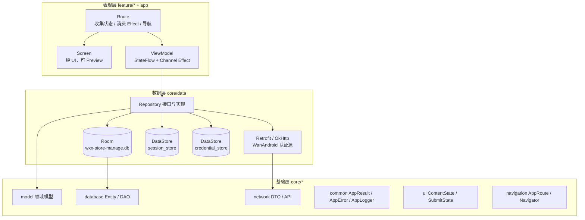

# WXXStoreManage

多仓库仓储管理 Android App，面向管理员（Admin）与仓管员（Operator），业务范围覆盖多仓库、SKU 库存、入库、出库与盘点。

当前处于 MVP 起步阶段：登录与会话链路、Room 只读数据路径、底部四个一级页已落地；库存同步、单据流程与角色授权尚未实现。

> 本文档描述 2026-10-26 的代码现状，只负责架构导读。开发约束与验证状态以 [AGENTS.md](AGENTS.md) 为准，业务术语以 [GLOSSARY.md](GLOSSARY.md) 为准，关键取舍见 [docs/adr](docs/adr/)。

## 1. 业务范围

| 维度 | 设计约定 |
| --- | --- |
| 角色 | Admin 拥有全部权限；Operator 只能创建与执行入库、出库、盘点录入，不能作废或审核 |
| 入库 / 出库状态 | `Draft → Pending → Completed / Cancelled` |
| 盘点状态 | `Draft → Counting → PendingReview → Completed / Cancelled` |
| 库存口径 | 唯一键为 `skuId + warehouseId`，数量为整数；可用量 = 现存量 − 锁定量 |
| 库存变更时机 | 入库 / 出库在 `Completed` 变更现存量；出库在 `Pending` 先占用锁定量；作废不改变现存量 |
| 读模型 | Room 为唯一数据源，网络同步只写 Room，页面观察 Repository 暴露的 `Flow` |
| 写模型 | 在线优先，必须等待服务端确认；MVP 不做乐观库存更新与离线写队列 |

明确的非目标：离线写队列、批次 / 序列号 / 保质期、单位换算、供应商 / 采购 / 报表、扫码、多语言、平板双栏、WorkManager 定时同步、动态取色。

## 2. 技术栈

| 分类 | 选型 | 版本 |
| --- | --- | --- |
| 语言 / 构建 | Kotlin、Java 17、AGP、Gradle Wrapper | Kotlin 2.2.10、AGP 9.4.0 |
| UI | Jetpack Compose、Material 3 | Compose BOM 2026.02.01 |
| 架构 | MVVM + UiState、Hilt、KSP | Hilt 2.60.1、KSP 2.3.12 |
| 导航 | Navigation 3 + kotlinx-serialization | 1.2.0 / 1.9.0 |
| 本地存储 | Room、DataStore Preferences | Room 2.8.5、DataStore 1.3.0 |
| 网络 | Retrofit、OkHttp、kotlinx-serialization | Retrofit 3.0.0、OkHttp 5.5.1 |
| 异步 | Kotlin Coroutines、StateFlow、Channel | 1.10.2 |
| 图片 | Coil | 3.3.0 |
| SDK | minSdk 24、compileSdk / targetSdk 37 | — |

依赖注入与 Room 统一使用 KSP，不使用 kapt。所有版本集中声明在 [gradle/libs.versions.toml](gradle/libs.versions.toml)。

当前**未接入**：Paging 3、WorkManager、ktlint、detekt。Paging 3 只计划用于库存与三类单据列表。

## 3. 架构总览

单 `:app` 模块，按包分层，依赖方向固定：



- 依赖方向：`feature/* → core/*`；`core/data → core/database + core/network + core/model`；`app → feature/* + core/*`。
- 禁止 feature 之间互相引用、core 反向依赖 feature、UI 直接使用 DTO / Entity / DAO / Retrofit。
- 不设 UseCase 层；Repository 接口与实现都位于 `core/data`。
- 页面阅读路径固定为 `Route → Screen → UiState / Action / Effect → ViewModel → Repository`。

## 4. 启动、会话与认证

### 启动链路

```text
WxxStoreManageApplication (@HiltAndroidApp)
└── MainActivity (单 Activity, edge-to-edge)
    └── WXXStoreManageTheme
        └── SessionGate
            ├── Loading    → 启动占位
            ├── LoggedOut  → LoginRoute（不进入 Nav3 返回栈）
            └── LoggedIn   → AppShell（NavDisplay + 底部导航）
```

`SessionGate` 由 [SessionGate.kt](app/src/main/java/com/wangxingxing/wxxstoremanage/app/SessionGate.kt) 按 `SessionState` 切换，是登录、登出与会话失效共用的唯一切换路径。会话是可持续观察的状态，因此登录成功不发送导航 Effect，这是对「异步导航用 Effect」的显式例外。

### 登录与记住凭据

```text
LoginScreen → LoginViewModel → AuthRepository
            → WanAndroidAuthApi（POST user/login）
            → 校验 errorCode == 0 且响应携带 Set-Cookie
            → SessionStore 加密保存 StoredSession
            → CredentialStore 按勾选保存或清除账号密码
```

- WanAndroid 只是可替换的临时认证源，隔离在 `AuthRepository` 之后；feature 不接触 WanAndroid 的接口、DTO、Cookie 或 `admin` 字段。
- 登录接口的 401 映射为 `AuthenticationFailed`，与已有会话失效的 `SessionExpired` 严格区分。
- 登录成功但拿不到 `Set-Cookie` 时判定失败，不落盘半成品会话。
- 记住账号密码只回填登录表单，不自动登录；密码与账号经 Keystore 加密后写入独立的 `credential_store`，会话则写入 `session_store`。
- 两个 DataStore 均被 [backup_rules.xml](app/src/main/res/xml/backup_rules.xml) 与 [data_extraction_rules.xml](app/src/main/res/xml/data_extraction_rules.xml) 排除在云备份和设备迁移之外。

### 登出与会话清理

`ProfileViewModel` 经 `SessionCleaner` 触发统一清理：

1. `DefaultSessionCleaner` 用 `Mutex` 串行化重复退出；
2. `AuthRepository.logout()` 尽力调用服务端登出，失败不阻止本地清理，最终清除 `session_store`；
3. `RoomBusinessDataCleaner` 清空 Room 业务数据；
4. 会话流变为 `null`，`SessionGate` 自动切回登录页并销毁主壳，返回栈随之清空。

## 5. 导航模型

| 组件 | 职责 |
| --- | --- |
| `AppRoute` | 所有路由键的公共接口，`@Serializable` 且实现 `NavKey`，由各 feature 声明 |
| `NavigationState` | 管理一级页选中态与各一级页独立的 `NavBackStack` |
| `Navigator` | 唯一导航入口，只提供 `navigate`、`goBack`、`replaceTop` |
| `AppShell` | 通过 `entryProvider` 注册路由，挂载 `NavDisplay` 与底部导航 |
| `TopLevelTab` | 首页、库存、单据、我的四个一级页的路由、标签与图标映射 |

- 底部四个一级页各自持有返回栈；组合时只渲染起始一级页与当前一级页，其余栈保留状态但不参与组合。
- 在一级页栈底再次返回时回到起始一级页，而不是退出应用。
- 每个 NavEntry 由 `rememberViewModelStoreNavEntryDecorator` 提供独立 ViewModel 作用域，返回重进不复用旧页面状态。
- ViewModel 不持有 `Navigator` 或 `Context`：用户点击导航走回调，异步完成后的导航走 Effect。

## 6. 目录结构

```text
com.wangxingxing.wxxstoremanage
├── app/                     Application、MainActivity、SessionGate、AppShell、TopLevelTab
├── core/
│   ├── common/              AppResult、AppError、AppLogger、调度器限定符与 DI
│   ├── data/                Repository、认证 / 会话 / 凭据、mapper、DI
│   ├── database/            AppDatabase、Entity、DAO、DI
│   ├── network/             Retrofit、OkHttp、WanAndroid API、DTO、DI
│   ├── designsystem/        固定品牌色主题、深色主题、字体
│   ├── ui/                  ContentState、RefreshState、AppendState、SubmitState、通用状态视图
│   ├── navigation/          AppRoute、NavigationState、Navigator
│   └── model/               领域模型（Warehouse、Sku、Stock、StockSummary、CurrentUser 等）
└── feature/
    ├── auth/                登录（model / route / screen / viewmodel）
    ├── home/                首页：启用仓库列表（含 mapper）
    ├── inventory/           库存：全局库存汇总（含 mapper）
    ├── documents/           单据入口：静态页，暂无业务数据
    └── profile/             我的：当前用户、退出登录（含 mapper）
```

规划中的 `inbound/`、`outbound/`、`stocktaking/` 尚未创建；单据入口页目前不持有数据与 ViewModel。

## 7. 数据层与错误模型

### Room

数据库 `wxx-store-manage.db`，version 1，导出 schema，禁止 `fallbackToDestructiveMigration`：

| 表 | 主键 | 关键字段 | 约束 |
| --- | --- | --- | --- |
| `warehouses` | `id` | `code`、`name`、`isActive`、`updatedAt` | — |
| `skus` | `id` | `code`、`name`、`unit`、`imageUrl`、`isActive`、`updatedAt` | — |
| `stocks` | `skuId + warehouseId` | `onHand`、`locked`、`updatedAt` | 外键级联删除，`warehouseId` 建索引 |

现有 DAO：

- `WarehouseDao`：观察启用仓库、批量 upsert。
- `SkuDao`：观察启用 SKU、批量 upsert。
- `StockDao`：全局库存汇总（`skuCount / onHand / locked`）、按仓库观察库存、批量 upsert。

领域模型 `Stock.available` 由 `onHand - locked` 计算，不单独持久化。Repository 在读路径上做 Entity → Domain 映射，并切到注入的 `@IoDispatcher`。

> 当前读路径已打通 Room，但**服务端库存同步尚未实现**：首次安装时仓库与库存表为空，首页与库存页会进入 `Empty` 状态。

### 网络

`NetworkModule` 提供单个 `OkHttpClient` 与两套 Retrofit：

- 默认 Retrofit 指向 `API_BASE_URL`（自建仓储服务的预留地址，默认 `https://api.example.invalid/`）。
- `@WanAndroidRetrofit` 指向 `WANANDROID_BASE_URL`（默认 `https://wanandroid.com/`），当前只承载登录 / 登出。
- 两个地址都要求以 `/` 结尾，通过 Gradle property 注入；Debug 构建安装完整 BODY 日志，Release 不安装。
- Debug 构建额外引入 Reqable 用户证书信任，仅用于抓包调试，不进入 Release。

### 错误映射

写操作返回 `AppResult<T>`：`Success(data)` 或 `Failure(AppError)`；读操作返回 `Flow<T>`。异常在数据层映射为 `AppError`，UI 只消费 `AppErrorType`，绝不展示 `throwable.message` 或服务端原文。

| 来源 | `AppErrorType` |
| --- | --- |
| `IOException` | `NetworkUnavailable` |
| HTTP 400 / 422 | `Validation` |
| HTTP 401 | `SessionExpired`（登录接口单独映射为 `AuthenticationFailed`） |
| HTTP 404 | `NotFound` |
| HTTP 409 | `Conflict` |
| HTTP 5xx | `ServiceUnavailable` |
| 其他异常 | `Unknown` |

`CancellationException` 必须原样抛出，不能映射为业务错误。[AppErrorMapper.kt](app/src/main/java/com/wangxingxing/wxxstoremanage/core/data/mapper/AppErrorMapper.kt) 与 [AuthErrorMapper.kt](app/src/main/java/com/wangxingxing/wxxstoremanage/core/data/mapper/AuthErrorMapper.kt) 分别处理通用请求与登录语义。

### 日志

统一通过注入的 `AppLogger` 输出结构化事件（`feature / action / phase / context / durationMs / throwable`），禁止裸 `Log.e`。`LogcatAppLogger` 会按 UTF-8 字节对超长日志分片，避免 logcat 单条约 4KB 的截断。

## 8. 页面与状态契约

| Feature | 路由 | 当前能力 | 数据来源 |
| --- | --- | --- | --- |
| auth | 无 NavKey，由 `SessionGate` 承载 | 登录、密码可见性切换、记住账号密码、字段校验、提交态 | `AuthRepository` |
| home | `Home` | 展示启用仓库列表 | `WarehouseRepository` → Room |
| inventory | `Inventory` | 展示全局 SKU 数、现存量、锁定量、可用量 | `StockRepository` → Room |
| documents | `Documents` | 单据入口静态页 | 无 |
| profile | `Profile` | 展示当前用户、头像、退出登录确认 | `AuthRepository` + `SessionCleaner` |

状态契约位于 `core/ui`：

- `ContentState<T>`：首屏 `Loading / Empty / Content / Error`。
- `SubmitState`：写操作 `Idle / Submitting / Success / Error`。
- `RefreshState`、`AppendState`：为后续刷新与分页保留；当前页面尚未接入刷新和分页。
- 登录表单使用显式字段 + `fieldErrors: Map<Field, AppErrorType>`；退出登录使用独立 `SubmitState`，确认弹窗由可观察布尔状态承载。
- 一次性行为通过 `Channel<XxxEffect>(BUFFERED).receiveAsFlow()` 暴露，只在 Route 中消费；同一事件不会同时写入 State 和 Effect。

UI 细节：Material 3 固定品牌色，不启用动态取色；360dp 手机优先；所有用户可见文案走 string resource；Coil 只用于商品图与用户头像。

## 9. 测试体系

| 源集 | 运行方式 | 覆盖内容 |
| --- | --- | --- |
| `src/test` | JUnit4 + `kotlinx-coroutines-test` + Turbine + MockWebServer；Robolectric + Compose UI Test | 错误映射、Stock 语义、各 ViewModel 状态与重试、AuthRepository、SessionCleaner、日志分片、登录页渲染与交互 |
| `src/androidTest` | 真机 / 模拟器，真实 SQLite 与 Hilt 注入 | DAO SQL 口径、外键级联、upsert、数据库 schema 与 migration、凭据密文落盘、SessionGate 会话切换 |
| `src/screenshotTest` | Layoutlib（`com.android.compose.screenshot`） | Login / Home / Inventory / Documents / Profile 在九种窗口尺寸、空态、错误态与 1.5 倍字体下的视觉基准 |

- Robolectric 的 `android-all-instrumented` 由 `:app:syncRobolectricDependencies` 预同步到 `app/build/robolectric-deps`，测试进程不联网下载。
- 截图基准位于 `app/src/screenshotTestDebug/reference/`，只在 macOS 上生成与校验；Layoutlib 跨平台差异较大，不纳入 Linux CI。
- CI 位于 [.github/workflows/ci.yml](.github/workflows/ci.yml)：Ubuntu 上执行构建、Lint、单元测试与覆盖率，并在模拟器上执行 `connectedDebugAndroidTest`。

## 10. 构建与运行

前置条件：JDK 17、Android SDK 37、可用的 Gradle Wrapper。

```bash
# 构建 Debug
./gradlew :app:assembleDebug

# 静态检查
./gradlew :app:lintDebug

# 单元测试与覆盖率
./gradlew :app:testDebugUnitTest
./gradlew :app:jacocoTestReport

# 截图测试（仅 macOS）
./gradlew :app:validateDebugScreenshotTest
./gradlew :app:updateDebugScreenshotTest

# 设备测试（需连接设备或模拟器）
./gradlew :app:connectedDebugAndroidTest
```

认证源与后端地址可通过 Gradle property 覆盖：

```properties
API_BASE_URL=https://your-backend.example/
WANANDROID_BASE_URL=https://wanandroid.com/
```

以上命令是仓库定义的验证入口；最近一次实际执行情况与测试数量记录在 [AGENTS.md](AGENTS.md) 第 10 节，本文不重复声明通过状态。

## 11. 文档索引

| 文档 | 内容 |
| --- | --- |
| [AGENTS.md](AGENTS.md) | 交付约束、包结构、页面模板、状态 / 协程 / 日志规范与验证要求 |
| [GLOSSARY.md](GLOSSARY.md) | 商品、库存、单据状态、身份会话与角色的标准术语 |
| [docs/adr/0001](docs/adr/0001-single-module-package-boundaries.md) | 单模块 + feature 包边界 |
| [docs/adr/0002](docs/adr/0002-room-ssot-online-inventory-writes.md) | Room 作为读 SSOT，库存写在线优先 |
| [docs/adr/0003](docs/adr/0003-navigation3-and-navigator.md) | Navigation 3 + 统一 Navigator |
| [docs/adr/0004](docs/adr/0004-wanandroid-as-temporary-auth-source.md) | WanAndroid 作为临时认证源 |
| [docs/adr/0005](docs/adr/0005-session-persistence-optimistic-restore.md) | 会话持久化与乐观恢复 |
| [docs/adr/0006](docs/adr/0006-remember-login-credentials.md) | 记住登录凭据 |

## 12. 后续方向

1. 实现单据领域：入库、出库、盘点的列表与详情，状态流转与在线提交。
2. 接入库存同步：启动、进入页面与手动刷新，网络结果写入 Room，失败保留旧数据。
3. 接入 Paging 3：库存列表与三类单据列表使用 `RemoteMediator + Room PagingSource`。
4. 实现角色授权：Admin 作废 / 审核 / 基础资料维护，Operator 仅执行录入；UI 隐藏与服务端校验并行。
5. 接入稳定后端后移除 WanAndroid 临时认证源与 Reqable 调试依赖。
